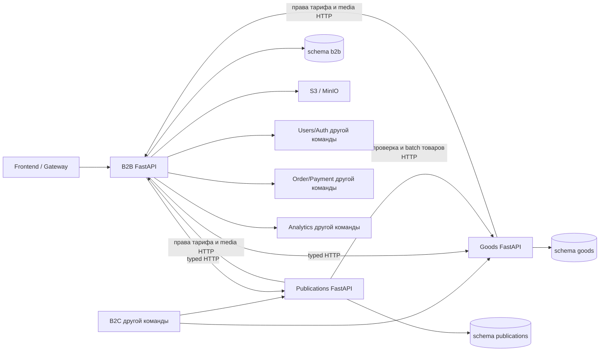

# Архитектура

B2B владеет `seller_stores`, `seller_subscriptions`, `seller_delivery_settings`, `media_files`. Goods владеет `seller_catalogs`, `products`. Publications владеет `seller_authors`, `posts`, `post_products`. В Compose одна PostgreSQL 16, три схемы с отдельными владельцами/логинами. Нет межсхемных JOIN и FK. Каждый процесс использует только свой DSN и свою историю Alembic. Каталог и автор содержат только внешний seller UUID как строку-мьютекс; это не копии магазина.

`api` принимает DTO и вызывает `services`; `repositories` содержит выборки и блокировки. `models` — ORM; `schemas` — Pydantic. Общая библиотека содержит транспорт и wire DTO, без общей БД. B2B не импортирует ORM Goods/Publications для бизнес-операций. Health-фабрика знает только таблицу своего сервиса. В тестовом bootstrap импорт трёх metadata нужен для изолированной SQLite; production использует Alembic.

## Доверие и права

Пользователь передаёт cookie, B2B проверяет JWT RS256 и обращается к Users за подтверждённым текущим профилем. После этого выбирает магазин по `ownerUserId`, проверяет seller role и завершённость onboarding. Идентификаторы продавца из пользовательского JSON никогда не используются для назначения владельца. Критические DTO запрещают неизвестные поля.

Goods и Publications — внутренние приложения. Их HTTP API требует `X-Service-Key` и доверяет назначению seller ID аутентифицированным backend-компонентом. Ключ не передаётся браузеру. Каждый запрос ресурса дополнительно ограничен `id AND seller_id AND deleted_at IS NULL`; чужой ресурс возвращает 404. Внешним интеграциям передаются server-derived seller IDs; ответ заказа повторно проверяется на принадлежность магазину.

Текущая модель service key предполагает доверенную внутреннюю команду/сеть; ключ даёт доступ ко внутренним данным всех продавцов. Перед выдачей доступа менее доверенным потребителям следует согласовать отдельные read-only credentials/scopes или mTLS. Публично выставляется B2B; buyer-клиент идёт через B2C.

## Транзакции

Onboarding сначала фиксирует `pending` магазин, уникальные owner и username и дефолтные настройки. После идемпотентного подтверждения роли в Users активирует магазин. При сбое резервирование сохраняется: повторный запрос продолжает ту же регистрацию. Глобальные роли и user DB B2B не изменяет. UNIQUE разрешает конкуренцию на первом создании, последующая операция блокирует строку магазина.

Создание товара берёт `INSERT ... ON CONFLICT DO NOTHING` и `SELECT ... FOR UPDATE` на строке `goods.seller_catalogs`, читает подтверждённые права по HTTP и считает неудалённые товары в той же транзакции. Создание публикации аналогично блокирует `seller_authors`. Поэтому несколько процессов не могут одновременно использовать последнее место Free. Черновики входят в квоту публикаций; удаление освобождает место. Все изменения в сервисе транзакционны; отклонённый PATCH не изменяет данные.

Premium не активируется по клиентскому `tier`. Checkout сохраняется с idempotency key. `sync` только запрашивает состояние Payment и проверяет seller, reference, tier и срок. Повтор одного checkout возвращает сохранённый результат; другой ключ при pending/active подписке отклоняется до нового обращения к Payment. Истёкшее подтверждение даёт Free даже до следующего sync. Goods заново получает права при чтении/записи; ранее online товар при потере прав отображается out_of_stock и `purchasable=false`. Существующий избыток товаров после downgrade не удаляется; новые создания запрещены.

Точка принятия решения по тарифу — HTTP-проверка внутри транзакции владельца данных. Общей распределённой транзакции с Payment нет. Если сетевой timeout произошёл после commit upstream, результат записи может быть неизвестен вызывающей стороне: следует сверить список/детали; автоматических повторов мутаций нет.

## Публикации и изображения

HTML очищается до сохранения bleach с разрешёнными тегами, без атрибутов/URL и комментариев. Публикация проверяет непустой текст после очистки, заголовок, квоты и принадлежность новых product IDs. Связи хранят порядок. При перестановке сначала удаляются старые связи, затем вставляются новые в одной транзакции, чтобы UNIQUE(position) не конфликтовал.

Product IDs — внешние ссылки без FK между сервисами. Goods использует soft delete, batch возвращает исторический товар с `deletedAt`, `saleMode=out_of_stock`, `purchasable=false`. Старые ссылки остаются; новая ссылка на удалённый товар запрещена. При конкурентном удалении после проверки ссылка может сразу стать исторической, но никогда не даёт права покупки. Publications read API показывает только published; seller API отдельно предоставляет drafts/preview.

В B2B Product/Post вкладывается seller один раз на страницу; products для постов выбираются batch-пакетами до 100 ID с сохранением порядка. Счётчики и профиль не копируются в Goods/Publications. Неизвестные рейтинг и engagement возвращаются null. Если товарная секция недоступна после подтверждённой записи публикации, возвращается сохранённая публикация с `unavailableSections=["products"]`.

Файлы ограничены по байтам и пикселям; Pillow проверяет реальный формат и декодирует/перекодирует изображение в thread pool. Ключ случайный, имя клиента не используется. Boto3 работает в thread pool с timeout; метаданные создаются только после успешного put. Привязка URL требует найденного Media этого seller. Непроизвольные внешние URL не принимаются. Удаление неиспользованных файлов выполняется в maintenance window (README).

## Отказы и наблюдаемость

HTTP-клиенты имеют timeout, не следуют redirect и не повторяют мутации. Проверяют envelope и typed DTO; некорректный ответ upstream — 502, недоступность — 503. Сообщения внешних сервисов и SQL не отражаются клиенту. Dashboard параллельно собирает разделы, отличает подтверждённый 0 от null/unavailable. Request ID передаётся по HTTP, JSON-логи не содержат cookie, JSON payload, секреты и query.

Kafka реализована по обязательному уточнению пользователя: KRaft, aiokafka, local transactional outbox и durable consumer inbox в каждой схеме. B2B публикует seller.created и обрабатывает Goods/Publications события в метаданные активности; Goods/Publications независимо получают seller.created. HTTP остаётся источником актуальных прав и квот. Общая инфраструктура B2C, Users, Orders, Payment и delivery отсутствует. OpenAPI описывает три REST API и internal event operations; gateway prefix задаётся один раз через API_PREFIX. Предлагаемые контракты и гарантии: [KAFKA_CONTRACT.md](KAFKA_CONTRACT.md).
